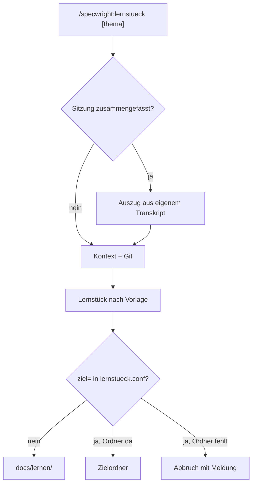

# Befehl Lernstück: planen und bauen

## Worum es ging

In einer Session mit Claude entsteht oft mehr Code, als man nebenher versteht. Specwright konnte bisher nur Regeln für Agenten festhalten (`/add-learning`), nichts für den Menschen. Ziel war ein Befehl, der nach einem Thema eine Lerndatei schreibt, und zwar dort, wo man liest, ohne dass ein persönlicher Pfad ins öffentliche Repo gelangt.

## Was gebaut wurde und warum

Ein Befehl in Specwright ist eine Arbeitsanweisung an Claude in drei Teilen: eine kurze Befehlsdatei, die auf einen **Workflow** verweist (die ausführliche Anleitung mit Schritten), und eine **Vorlage** (die Gliederung des Ergebnisses). Gebaut wurden genau diese drei Dateien: `.claude/commands/specwright/lernstueck.md`, `specwright/workflows/core/lernstueck.md`, `specwright/templates/docs/lernstueck-template.md`. Es gibt keinen Programmcode.

Damit der Befehl bei allen Nutzern ankommt, steht jede Datei als Zeile in der **Lieferliste** `specwright/manifest.tsv`. Aus ihr lesen alle Installer; ein Prüfskript schlägt Alarm, wenn eine Datei fehlt. Der Installer-Test zählt die Befehle fest ab, deshalb wurde er von 23 auf 24 gesetzt.

Zwei Stellen brauchten Recherche:

- **Lange Sitzungen** fasst Claude Code zusammen; danach kennt Claude den frühen Teil nur grob. Vollständig steht er im **Transkript**, einer Datei mit einer JSON-Zeile pro Ereignis. Die Kennung der eigenen Sitzung liegt in der Umgebungsvariable `CLAUDE_CODE_SESSION_ID`, und genau so heißt die Datei. Ein `jq`-Filter zieht nur Nutzer-Eingaben, Antworttexte und Fehlermeldungen heraus: aus 2 MB werden etwa 21 KB.
- **Ablage:** Standard ist `docs/lernen/` im Projekt. Eine optionale Datei `~/.specwright/lernstueck.conf` mit `ziel=…` lenkt um, etwa in einen Notiz-Vault. Der persönliche Pfad bleibt so auf dem eigenen Rechner.

## Entscheidungen und verworfene Wege

| Entscheidung | Verworfen | Grund |
|---|---|---|
| Neuer Befehl | `/add-learning` um einen Modus erweitern | anderes Ziel (Agenten-Regeln in Skill-Dateien), Vermischung macht beide unklar |
| Transkript über `CLAUDE_CODE_SESSION_ID` finden | Ordnernamen aus dem Arbeitsverzeichnis berechnen | Umwandlungsregel undokumentiert; die Kennung trifft die Datei direkt |
| Transkript nur nach einer Zusammenfassung lesen | immer lesen | kostet Kontext ohne Nutzen, solange Claude alles noch sieht |
| Zwei Zeilen `jq`/`sed` im Workflow | eigenes Shell-Skript | Skript bräuchte Test, Manifest-Zeile und Pflege für alte Bash |
| Fehlender Zielordner → Abbruch | Ordner anlegen oder nach `docs/lernen/` ausweichen | ein Tippfehler im Pfad würde still einen Müll-Ordner erzeugen |
| Vorlage unter `templates/docs/`, für Projekt und global | unter `templates/sdlc/` | dort prüfen Wächter Format-Zeile und Leser-Marker, die für ein Lernstück nicht passen |

## Muster und Methoden

- **Konvention vor Konfiguration:** ohne Einstellung gilt ein sinnvoller Standard (`docs/lernen/`), wer will, überschreibt ihn mit einer Zeile. Man muss nichts einrichten, um anzufangen.
- **Eine Quelle der Wahrheit:** alle Installer lesen dieselbe Liste statt eigener Listen. Früher fehlte ein Befehl, weil er in einem von drei Installern vergessen wurde; seit der Liste fällt so etwas im Prüflauf auf.
- **Früh und laut scheitern (Fail fast):** ein falsch eingetragener Zielordner führt zum Abbruch mit Meldung statt zu einem stillen Ausweichen.
- **Hybrid-Lookup:** zuerst die Vorlage im Projekt, sonst die globale unter `~/.specwright`. Ähnlich zu einem Suchpfad (wie `PATH`), aber mit nur zwei festen Stufen.

## Sackgassen und Fehler

- **Selbstbezug beim Suchen:** Um die Markierung einer Zusammenfassung im Transkript zu finden, wurde nach `compact_boundary` gesucht. Treffer kamen nur aus den Transkripten der eigenen Sessions, weil der Suchbefehl selbst darin stand. Lehre: wer im eigenen Protokoll sucht, findet zuerst sich selbst; Treffer auf Struktur prüfen (`jq` auf Feld `subtype`), nicht auf Text.
- **zsh statt bash:** `grep -r --include=*.jsonl` brach mit „no matches found“ ab, weil zsh das Sternchen selbst auflöst. Lehre: Muster für Programme in Anführungszeichen setzen (`--include='*.jsonl'`).
- **Offene Annahme:** Ein echtes Transkript mit Zusammenfassung lag nicht vor. Der Workflow hat deshalb einen Rückweg (ganzen Auszug lesen), und die Markierung wird nach dem Merge von Hand geprüft.

## Diagramme

## Übertragen auf andere Projekte

- Jedes Werkzeug, das Dateien an Nutzer ausliefert, profitiert von einer einzigen Lieferliste plus Prüflauf; das gilt für Installer, Docker-Images und Deploy-Skripte.
- Persönliche Pfade gehören in eine lokale Einstellungsdatei mit Standardwert im Repo, nie ins Repo selbst, besonders bei öffentlichen Repos.
- Bevor man ein Skript schreibt, prüfen, ob zwei Zeilen in einer Anleitung reichen; jedes Skript ist Code, der getestet und gepflegt werden will.

## Selbsttest

1. **Warum findet der Befehl das Transkript über die Sitzungskennung und nicht über den Projektordner?**

    Antwort: Die Kennung steht in `CLAUDE_CODE_SESSION_ID` und ist zugleich der Dateiname. Den Ordnernamen müsste man aus dem Pfad nachbauen, und diese Regel ist nicht dokumentiert.

2. **Was passiert, wenn in `lernstueck.conf` ein Ordner steht, den es nicht gibt, und warum?**

    Antwort: Der Befehl bricht mit Meldung ab. Ein stiller Ausweichort oder ein neu angelegter Ordner würde einen Tippfehler verdecken, und das Lernstück läge nicht dort, wo man es sucht.

3. **Warum musste der Installer-Test geändert werden, obwohl die Installer selbst unverändert blieben?**

    Antwort: Die Installer lesen die Lieferliste und liefern den neuen Befehl automatisch aus. Der Test zählt die Befehle aber fest ab (23) und wäre mit 24 rot geworden.

4. **Wann liest der Befehl das Transkript, und was liest er daraus?**

    Antwort: Nur wenn die Sitzung zusammengefasst wurde. Er liest einen Auszug aus Nutzer-Eingaben, Antworttexten und Fehlermeldungen, und davon den Teil vor der letzten Zusammenfassung.

## Quellen

- Commits: `02402a3` intent(INT-2026-039): Lernstück aus einer Session — angenommen · `8a3faf1` plan(INT-2026-039): Plan freigegeben
- Dateien: `.claude/commands/specwright/lernstueck.md`, `specwright/workflows/core/lernstueck.md`, `specwright/templates/docs/lernstueck-template.md`, `specwright/manifest.tsv`, `scripts/test-installers.sh`
- Plan: `intent/INT-2026-039-lernstueck-aus-session/plan.md`
- Sitzung nicht zusammengefasst; Transkript nicht nötig.
