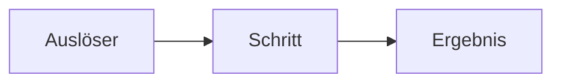

# [Thema in wenigen Worten]

## Worum es ging

[Ausgangsproblem aus Sicht des Nutzers oder des Projekts, zwei bis vier Sätze. Was war vorher, was sollte danach anders sein?]

## Was gebaut wurde und warum

[Der Lösungsweg als Erklärung, nicht als Dateiliste. Fachbegriffe beim ersten Auftreten erklären. Dateien nur als Verweis `pfad/datei:zeile`, wenn Kontext, Git oder Transkript sie belegen.]

## Entscheidungen und verworfene Wege

| Entscheidung | Verworfen | Grund |
|---|---|---|
| [was gewählt wurde] | [mindestens eine Alternative] | [warum nicht] |

## Muster und Methoden

- **[Name des Musters]:** [in Alltagssprache, was es tut und wozu]. [Setzt der Code es nur teilweise um: „ähnlich zu [Muster]: [was fehlt oder anders ist]“.]

## Sackgassen und Fehler

[Nur falls es welche gab; sonst Abschnitt weglassen.]

- **[Was versucht oder schiefgelaufen ist]:** [woran es scheiterte]. Lehre: [was man beim nächsten Mal anders macht].

## Diagramme

[Höchstens zwei, nur wenn ein Bild etwas klarer macht als Text; sonst Abschnitt weglassen.]

## Übertragen auf andere Projekte

- [Wo dasselbe Problem anderswo auftritt und was davon sich übertragen lässt, was nicht.]

## Selbsttest

[3 bis 5 Fragen, die Verständnis prüfen, nicht Auswendiglernen.]

1. **[Frage]**

    Antwort: [Antwort in zwei bis drei Sätzen.]

## Quellen

- Commits: [`sha` Titel]
- Dateien: [`pfad/datei`]
- [Hinweis, falls der frühe Teil der Sitzung nur aus der Zusammenfassung stammt.]
